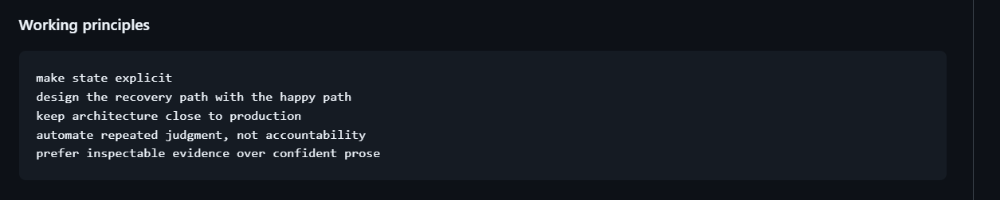
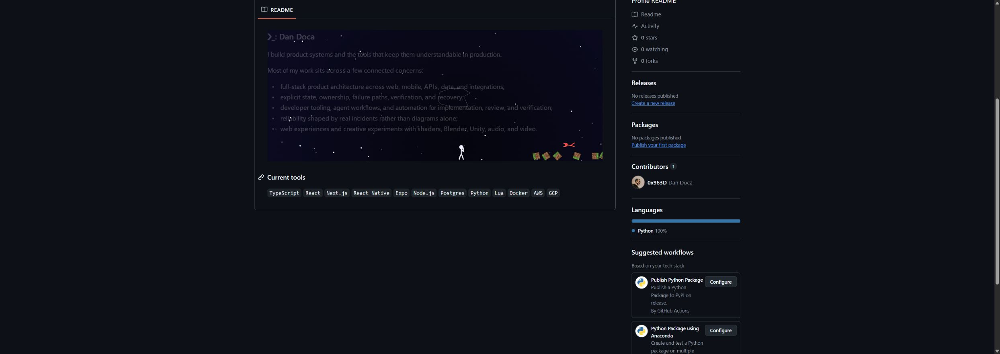
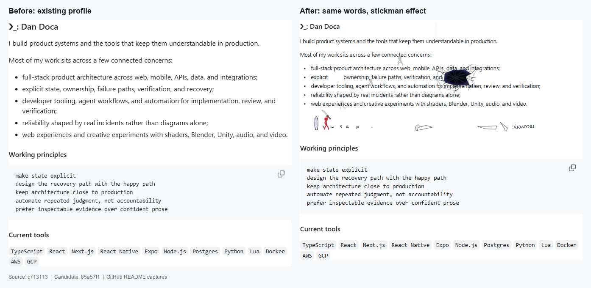

# Chrome playback correction

Verified implementation:
[`82da142`](https://github.com/0x963D/0x963D/tree/82da142803ba9e3358ae07e9eb294a44eef2a304),
compared with deployed base `42f2ed222d1e43916ca7c9e382678d43453a6e63`.

In Dan's signed-in Chrome, GitHub's explicit dark theme rewrote the combined
theme/motion source condition to
`(prefers-color-scheme: light),(prefers-color-scheme: dark)`.
Chrome reported reduced motion as false but selected `fight-dark-still.svg`.
The original browser QA did not exercise that account-theme override.

The corrected README separates theme visibility from motion selection. GitHub's
theme-fragment links show one picture; each picture uses a motion-only source
condition and an animated fallback. The requested Working principles heading and
code block are removed. The introduction, Current tools, and all four SVGs are
unchanged.

Before, the section Dan requested removing, from his supplied screenshot:

After, the corrected immutable README in Dan's signed-in Chrome:

On October 31, 2026, browser inspection of the candidate confirmed:

- GitHub remained in explicit dark mode, with reduced motion false.
- The visible image loaded `fight-dark.svg` from the exact candidate revision.
  The alternative light image had zero width and its parent link was hidden.
- Both source conditions remained `(prefers-reduced-motion: reduce)` and did not
  match. Two captures of the same image area differed, confirming playback.
- Current tools was the only heading below the animation. Working principles
  and its code block were absent.

A fresh read-only Codex reviewer examined the exact candidate against the base
and found no actionable issues. Independent checks passed for regeneration,
full-diff whitespace, identical SVG blobs, exact requested text deletion,
unchanged introduction/tools, and the theme-link/motion-source markup. Heading,
word, and alt-text escaping remained effective against malicious sample text.
Still assets preserve the introduction and contain no animation. No scripts,
event handlers, active embedded content, or external assets were introduced.

The independent merge score was 9.5/10, with a deduction for reliance on GitHub's
theme-fragment behavior. Go-live confidence was 9/10. The reviewer inspected the
after screenshot and relied on the parent's actual Chrome playback check.
Reduced-motion-on, explicit light theme, and narrow-screen browser checks were
not repeated for this correction. Motion-only conditions and unchanged still
assets were checked independently; existing mobile typography is unchanged.
No user browser or OS settings were changed. Local security review was sufficient
for this static README correction; no hosted or paid review ran.

The release commit adds only this evidence and screenshots after the reviewed
implementation. [PR #3](https://github.com/0x963D/0x963D/pull/3) records the final
commit, merge, and live verification. Reverting that merge restores the preceding
profile revision, including its known Chrome selection defect.

## Original release verification

The historical evidence below describes the initial release before this correction.

Verified animation/source commit:
[`85a57f1`](https://github.com/0x963D/0x963D/tree/85a57f1552435e6393c9ea5e43c7ad0ebabb92ed).
The original profile wording is from
[`c713113`](https://github.com/0x963D/0x963D/blob/c7131138373ff58aeea55916254a30097f5dd1f5/README.md).

[Watch the full animation loop](fight-preview.mp4).

The heading, introduction, and all five bullets now use the existing wording
verbatim, with no extra greeting, summary, emoji, or duplicated bio. The generator
reads that content from `fight/profile.md`. Working principles and current tools
remain unchanged native Markdown below the image.

Checks performed on October 31, 2026:

- Compared `fight/profile.md` with the original Git revision, ignoring trailing
  blank lines only. The content matches.
- Reconstructed the text in both static SVGs and compared it with the source
  introduction. The words and punctuation match, in order.
- Checked the generated README remainder against the original source. It matches
  and does not repeat the introduction.
- `python fight/make_fight.py --check` passes for all four SVGs and the README.
- SVGs parse successfully, have unique IDs, and resolve their clip references.
- The immutable GitHub README loads its matching SVG assets. Both reduced-motion
  variants select still files and produce identical screenshots over time.
- Inspected the introduction, chase, and reset; recorded a complete loop from
  the matching local SVG. Normal animation loads without a script or external
  asset dependency.
- At 390px, GitHub has no document-wide horizontal overflow. The fixed-width
  SVG scales down like the reference, so its text is small on phones. The full
  introduction is also present in the image's alt text. The existing principles
  code block scrolls horizontally on narrow screens.

Dan accepted candidate
[`43639e0`](https://github.com/0x963D/0x963D/tree/43639e03f27f9394eed54b8ec1840ca59a80b918)
and authorized publication on October 31, 2026.

## Independent release review

A fresh, read-only Codex reviewer examined
`43639e03f27f9394eed54b8ec1840ca59a80b918` against
`c7131138373ff58aeea55916254a30097f5dd1f5`. No correctness or security findings
blocked release. The reviewer independently verified:

- `python -B fight/make_fight.py --check` passes for the four SVGs and README.
- The profile source matches the original README. Both static introductions
  preserve its words and punctuation, and the native Markdown remainder is unchanged.
- Comparison with the pinned upstream confirms the original choreography, with
  scoped profile layout, word targets, reproducibility, and reduced-motion changes.
- SVG XML, unique IDs, clip references, and all 1,190 animation tracks per animated
  theme pass structural checks. Still assets contain no animation.
- Heading, word, and alt-text inputs escape markup. SVGs contain no scripts,
  event handlers, external resources, or active embedded content.
- The committed before/after image was inspected. The preview video lasts 33 seconds.
  The implementation at `85a57f1` matches the reviewed candidate.

The review found one cosmetic trailing blank line at the end of the generator.
That line was removed during closeout. The generated SVGs, profile wording, and
root README remain byte-identical to the accepted candidate. The final release
check covers the full branch diff and regenerates no files. This report and that
whitespace correction are the only changes after independent review.

Browser theme, reduced-motion, and mobile coverage comes from the source-bound QA
above. The reviewer did not repeat browser QA because the shared browser was occupied.
Hosted review was unnecessary for this static README and local generator; security
review was performed locally. No CI workflow is configured in this repository.

The reviewer assigned a merge score of 9.5/10, accounting for platform-dependent
font regeneration and the now-resolved whitespace nit. Go-live confidence was
9/10, accounting for accepted small phone text and the browser coverage limitation.

Publication updates this profile repository's default `main` branch through
[PR #2](https://github.com/0x963D/0x963D/pull/2). The previous profile revision is
`c7131138373ff58aeea55916254a30097f5dd1f5`. Reverting the merge restores that README.
The PR records the final release commit and live-profile verification.
